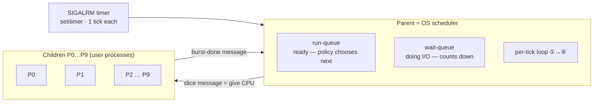

# os_proj1 — Simple Scheduling

Programming assignment #1 — due **Nov 17, 2026, 23:59 (KST)**.

## 1. Overview

You will build a user-level simulation of CPU scheduling using **real OS
mechanisms**: a parent process plays the role of the kernel scheduler, and
child processes play the role of user tasks. The simulation runs on real
`fork`ed processes, real timer interrupts (`setitimer`/`SIGALRM`), and real
IPC (System V message queues) — not a single-process discrete-event loop.

The assignment has one **mandatory implementation** and two optional stages:

| Implementation    | Content                                                   | Required?                    |
| ----------------- | --------------------------------------------------------- | ---------------------------- |
| Basic             | Round-robin scheduling of CPU bursts                      | **mandatory**                |
| + I/O             | I/O involvement (wait-queue)                              | optional                     |
| + Advanced policy | MLFQ **or** deterministic weighted VTIME + policy report   | optional (requires the I/O part) |

This repository includes the assignment specification, an example
[`workload.txt`](workload.txt), the public
[`check_trace.py`](check_trace.py), an optional
[`skeleton/`](skeleton/) starter, and focused OS-mechanism demonstrations in
[`examples/`](examples/). The examples are reference material, not files to
copy wholesale into a submission.

For repository maintenance, [regression tests](tests/README.md) cover the
checker and the starter's error-handling code. Run them from this directory
with `python3 -m unittest discover -s tests -v`.

What is graded is **observable behavior** — the live process/IPC execution,
the trace your program writes (Section 6), and your ability to explain your
own code (Section 7). Scheduling parameters and internal design are largely
your own choices; you declare them, and they are checked for internal
consistency.

For a basic RR submission, implement all of Sections 2, 3, and 6, including
child burst-completion notifications and all four summary metrics. Section 7
defines verification and Section 8 lists deliverables. Only positive-I/O
blocking and the advanced policies are optional; the completion protocol is
common to every stage.

## 2. Common infrastructure (all implementations)

At a glance — the parent is the OS scheduler; the children are user
processes; a timer drives it and a message queue carries CPU time both ways:



Each `SIGALRM` is one tick; the parent runs steps ①→⑥ (Section 6) once per
tick. A child normally blocks in `msgrcv`; a time-slice message wakes it for
one tick of progress, and it sends a burst-done message back when a CPU
burst ends.

For a broader, non-normative discussion of scheduler implementation choices,
see [Side note: Scheduler design
considerations](docs/scheduler-design-considerations.md). The rules in this
specification remain authoritative for the assignment.

### 2.1 Real mechanisms

Create 10 children with `fork`. The parent arms a periodic timer with
`setitimer` and uses each handled `SIGALRM` to drive one logical tick. At most
one child receives a slice in each tick, through a System V message queue
(`msgget`, `msgsnd`, `msgrcv`). The selected child consumes that message and
decreases its remaining CPU burst by exactly one.

The parent maintains the scheduling states: `RUN` is the selected task,
`RQ` contains ready tasks excluding `RUN`, and `WQ` contains tasks blocked
for positive I/O in the optional implementation. Tasks that have not arrived
are in none of these states. The basic implementation always has an empty
`WQ`. These states and their printed orders are required; their in-memory
representation is your choice.

**Design freedoms.**
The following are explicitly your decision; any working design is acceptable,
and grading is based on the trace plus the code walkthrough:

- **Message-queue topology** — one shared queue with an `mtype` addressing
  scheme, or one queue per child. `msgget(IPC_PRIVATE, 0666)` is
  recommended: the queue id is inherited across `fork`, and private queues
  cannot collide with other students' queues on a shared machine.
- **Signal-handler architecture** — do the scheduling work directly in the
  `SIGALRM` handler, or let the handler only set a `volatile sig_atomic_t`
  flag consumed by the main loop. The flag approach is recommended:
  `printf`/`sprintf` are not async-signal-safe, and a blocked `msgrcv` may
  fail with `errno == EINTR` when the signal arrives — your code must handle
  that either way.
- **Message layout and synchronization** — choose the `mtype` values,
  payload fields, and whether a slice reply includes burst completion or a
  separate notification carries it. No particular acknowledgement format or
  extra message is required; the completion contract below must hold.
- **Internal data structures** for the queues and bookkeeping. The specified
  queue orders describe observable behavior, not a required container type.

**Nonblocking checks and slice completion.** Drain unsolicited child
notifications, if your protocol has them, each tick with
`msgrcv(..., IPC_NOWAIT)`; never block waiting for a notification that may not
exist. The parent may block waiting for the result of a specific outstanding
slice. A child waiting for its slice blocks in plain `msgrcv`; this is the
simulation of "not running" — do not busy-wait.

Before step ② of tick `t+1` finishes, the parent must have established that
the child actually processed the slice sent at tick `t` and whether that
slice completed a burst. It must apply any resulting `BURST` or `IOREQ`
exactly once in that step. An empty nonblocking receive is not evidence that
the child processed its slice without completing a burst: the child may not
have run yet. A fixed sleep is not a completion guarantee either.

A per-slice reply carrying "still running" or "burst done, io=N" is one
recommended way to establish completion. It may be received during tick `t`
and saved, or awaited before applying results at tick `t+1`. A reply carrying
burst completion is itself the required notification; no duplicate
burst-done message is needed. Other protocols are allowed if they establish
the same completion guarantee using the required real child execution and
message queues. IPC receipt may happen early, but its `BURST`/`IOREQ` event
and scheduling-state changes must wait until tick `t+1`, step ②. At tick 0
there is no preceding slice to resolve. An `IDLE` tick sends no slice and
creates no result to await on the next tick.

All 10 children are forked at the start of the run, before the timer is
armed. A child whose task has not yet arrived (Section 2.2) needs no special
handling: it simply blocks in `msgrcv` and receives nothing until its task
is dispatched for the first time.

### 2.2 Input workload

The task set is an **explicit input** to the scheduler, separate from the
scheduling policy. Your program is invoked as:

```
./scheduler <policy> <workload_file>
```

Feeding the same workload file to different policies is what makes the policy
comparison valid; graders will also run your program on workload files you
have never seen.

**Workload file format.** UTF-8 text, whitespace-separated tokens. Blank
lines are ignored. A line whose first non-whitespace character is `#` is a
comment. Records use ASCII keywords and decimal numbers; comments may use
UTF-8 text. Grading workloads use ASCII whitespace as separators and before
comment markers, with LF or CRLF line endings; Unicode whitespace handling
is not required.

```
# my-workload.txt — example
tasks 10
# weights for P0 P1 ... P9 (public scheduling metadata)
weights 1 1 2 2 4 4 8 8 5 10
# task <index> <arrival> <npairs> <cpu1> <io1> <cpu2> <io2> ...
task 0 0 3   2 6   3 5   2 8
task 1 0 3   3 4   2 7   4 6
task 2 0 2   5 10  4 12
task 3 0 2   6 9   5 11
task 4 20 2  4 8   3 9
task 5 20 2  35 25 30 20
task 6 50 1  40 30
task 7 50 1  45 0
task 8 0 2   20 15 25 18
task 9 0 1   50 40
```

Rules:

- `tasks 10` — exactly 10 tasks; each index `0`–`9` appears exactly once.
- `weights <w0> ... <w9>` — required for VTIME and optional otherwise. It
  contains exactly 10 integer weights, one for each task `P0` through `P9`,
  in the range `1`–`10`; at least two weights must differ. When present, it
  appears exactly once as the next non-comment record after `tasks 10`.
  VTIME uses the weights; RR and MLFQ read and ignore them. This optionality
  preserves compatibility with older RR/MLFQ-only workload files.
- `<arrival>` — a non-negative tick at which the task joins the run-queue
  (`0` = present from the start; tasks arriving at the same tick join in
  ascending index order).
- `<npairs>` — the number of `(cpu, io)` pairs that follow, `>= 1`.
- `<cpu>` — CPU burst length in ticks, `>= 1`.
- `<io>` — I/O burst length in ticks, `>= 0`. `io = 0` means the task performs
  no I/O after that CPU burst and continues immediately with its next CPU
  burst.
- When a task exhausts its pairs, it **wraps around** to its first pair and
  repeats.
- Arrival and CPU/I/O values are in ticks. The basic implementation reads but
  ignores the `io` values.
- Each `task` record occupies one line; comments are full-line only; `task`
  lines may appear in any index order. Unseen grading workloads obey exactly
  these same rules.
- How you _generate_ a workload (distributions, ranges, tooling) is entirely
  up to you — only the file format is fixed.

**Numeric and size bounds.** Every integer token in a workload or trace has
1–18 ASCII decimal digits, with no sign; leading zeros are allowed unless
the trace field specifies a fixed format. The largest such integer is
`999999999999999999`. The tighter field-specific bounds above still apply.
Arrival, CPU/I/O duration, RR quantum, MLFQ quanta, and boost period may
exceed a 32-bit `int`; use a representation that covers the declared range
(`int64_t` is recommended). VTIME's quantum remains limited to 1–100.

A workload has at most 1,048,576 Unicode characters including line endings,
and at most 4,096 characters per physical line excluding its line ending.
The one-line task format therefore permits at most 1,020 pairs per task;
longer numeric tokens or extra whitespace reduce the number that fits.
Arrival ticks may be beyond 9999: those children still exist but never
become ready within the run. CPU and I/O bursts may also outlast the run.

Grading workloads satisfy this complete format and these bounds. Supporting
all such inputs is required. Rejection of malformed workloads is useful
defensive programming, but its diagnostics and behavior are not separately
graded; you need not implement a general-purpose input validator.

An example file, [`workload.txt`](workload.txt), is included in this
repository.

**Who reads what.**
The parent reads the task count, the public weights when present, and the
arrival ticks.
Each child reads (or is handed) its **own** burst sequence. You may parse the
entire workload before `fork` and let children inherit their entries, or let
each child read its entry afterward. Parsing, validating, or retaining the
input in parent memory is allowed.

The information boundary concerns **runtime decisions**: each child owns
its CPU-burst progress, pair advancement, and completion notification. The
parent owns scheduling state and the I/O countdowns reported by children.
It must not use future burst values to choose a task, advance CPU-burst state,
or manufacture completion events. It learns completion through the child's
message, even when it parsed the input earlier. The grading checker can use
both the full workload and trace to reconstruct the expected behavior.

### 2.3 Simulation length, termination, and cleanup

The simulation runs for exactly **10,000 ticks** (`t = 0 … 9999`) and then
terminates. Choose your timer tick interval as an **integer number of
milliseconds in the range 1–10** and declare it in the trace header
(Section 6); the expected duration is 10–100 seconds, and actual elapsed
time may be longer (Section 2.4). Children never exit on their own — they
run until the parent terminates them.

If tick 9999 sends a slice, confirm its actual processing by the child before
writing the summary and terminating children. A completion on that slice
would be applied at tick 10000, which is outside the run: do not add a tick
line, `BURST`/`IOREQ`, or queue transition for it. Likewise, do not apply the
last line's pending preemption move to the summary counters. The final CPU
tick is counted once in tick 9999's `RUN` line.

After logging tick 9999, confirming its slice if any, and writing the trace
summary (Section 6), the parent:

1. disarms the timer and sends `SIGTERM` to all children,
2. reaps every child with `wait`,
3. removes the message queue(s) with `msgctl(..., IPC_RMID, ...)`,
4. closes the trace file (`schedule_dump.<policy>.txt`, Section 6) and exits
   with status 0.

Leaving orphan processes or stale message queues behind will cost points —
System V queues are system-global and survive process death. While
developing, check with `ipcs -q` and clean up with `ipcrm`.

### 2.4 Timing realism

A tick is **logical**: one handled `SIGALRM` advances `t` by exactly 1.
Standard signals do not queue, so under load several timer expirations may
coalesce into one delivered signal — logical time then falls behind
wall-clock time. That is not a bug in your program; it is the real cost of
timer-driven scheduling, and you are asked to measure it: the trace summary
(Section 6) must report `expected_ms` (your declared `tick_ms` × 10,000) and
`elapsed_ms` (wall-clock time from arming the timer through handling tick
9999 and confirming its slice if any, before summary output and cleanup;
e.g. via `clock_gettime`).
How — and whether — you detect lost ticks is your choice; explaining the gap
between the two numbers is part of the advanced-policy report (Section 5.3).

## 3. Basic implementation (required): Round-robin scheduling

The parent implements RR with a FIFO ready order, tracks the running task's
remaining quantum, and accounts for each task's waiting time. Choose and
declare the scheduling parameters within the following rules.

Rules that pin down the basic behavior:

- **Scheduling parameters.** The time quantum is a positive integer of your
  choice; the tick
  interval must lie in 1–10 ms (Section 2.3). Declare both in the trace
  header (Section 6).
- **Arrival and initial order.** A task joins the **tail** of the run-queue
  at its arrival tick; tasks arriving at the same tick join in ascending
  index order. Tasks with `arrival = 0` are already in the run-queue before
  tick 0, in ascending index order, and the lowest index is dispatched first.
- **Burst completion (basic).** When a task's remaining CPU burst reaches 0,
  it skips the `io` value of the pair it just finished, advances to the next
  `(cpu, io)` pair of its workload entry (wrapping around if exhausted), and
  is ready to advance that new burst on its next slice. One slice decreases
  the CPU-burst counter exactly once, even at a pair boundary. The task stays
  runnable, and no I/O is simulated. It must still report burst completion
  (Section 2.1); the parent records `BURST` at the next tick's step ② without
  changing the task's queue placement or remaining quantum.
- **Quantum.** The dispatcher always takes the **head** of the run-queue; a
  task whose quantum expires is preempted and moved to the tail. Advancing to
  the next burst does **not** reset the quantum — the quantum is reset only
  when a task is dispatched.

## 4. Optional implementation: I/O involvement

Burst-completion reporting and the one-tick application rule are common to
all implementations. This extension adds blocking for **positive** I/O
durations; basic RR always records `BURST` and ignores the reported I/O.

### The child process

When a slice completes a CPU burst, the child reports the `io` value from
the pair it just finished and advances to the next pair. It waits for another
slice before advancing that next CPU burst. The child does not count down
I/O time or sleep for the workload's I/O duration; the parent models that
duration through scheduling state.

### The parent process

At the next tick's step ②, a positive-I/O completion moves the task from
`RUN` or `RQ` to `WQ`. At step ① of subsequent ticks, the parent decreases
its I/O countdown. Reaching zero returns the task to the ready queue under
the selected policy. A waiting task receives no slices. Section 6 fixes the
order of these transitions relative to arrivals, dispatch, and preemption.

**Information flow.**
This is the point of the I/O extension: the parent cannot predict completion
from workload data (Section 2.2), so **the burst-done message is the only way the
parent learns that a CPU burst has ended**. The notification carries the
`io` value of the pair the child just finished and identifies its sender
unambiguously. A logical task index, a PID mapped to that index, the message
type, or the receiving queue may supply the identity. When applying a
positive-I/O completion at the next
tick's step ②, the parent moves that task to the wait-queue for `io` ticks —
even if it had just been preempted into the
run-queue a moment earlier. After sending, the child simply blocks in
`msgrcv` waiting for its next time slice; there is no explicit "I/O done"
notification — time-slice messages resuming _is_ the notification. The
wait-queue values printed in the trace are the parent's countdown of the
reported `io` values.

Two timing rules make this exactly reproducible:

- **The one-tick lag is normative:** burst completion caused by the slice
  of tick `t` is applied at step ② of tick `t+1`, whether the parent receives
  the message in that step or uses a result received and saved earlier.
  This is what the Section 6 example shows and the checker enforces.
  Section 2.1 defines the completion guarantee; it leaves the protocol design
  to you.
- **`io = 0` is handled exactly like the basic burst advance:** the child
  still sends the burst-done message (carrying `io=0`), but the parent logs
  `ev: BURST` instead of `IOREQ`, the task stays where it is (running, with
  its current `q_left`, or in the run-queue), never enters the wait-queue,
  and contributes nothing to `total_io` or `io_resp`.

## 5. Optional advanced policy and comparison (requires the I/O part)

Choose **one** advanced policy: MLFQ or deterministic weighted VTIME. Both
are selected at run time and use the same I/O implementation from Section 4.
Implementing both is welcome, but the advanced-policy bonus is capped at the
points shown in Section 7.

### 5.1 MLFQ

Implement multi-level feedback queue scheduling as a second policy,
selectable at run time (`./scheduler mlfq <workload_file>`). The structure
is yours to design, within the definition of MLFQ:

- **Two or more levels**, each with its own positive-integer quantum —
  declare them in the trace header as `levels=<n> quanta=<q0,q1,...>`.
  Dispatch from the highest non-empty level; round-robin within a level. New
  arrivals — including the tasks present before tick 0 — enter at the **top
  level**. A running task
  is never displaced mid-quantum by a higher-level task becoming ready; the
  level rule applies only at dispatch (Section 6, step ④).
- **Demotion is required**: a task that exhausts its quantum at level `k`
  moves to level `k+1` (at the bottom level it rotates in place). The event
  is still logged as `PREEMPT` — the new level is visible in the next line's
  `RQk` lists.
- **Priority boost is optional**; declare its non-negative period as
  `boost=<ticks>` (`boost=0` for none). Boost semantics: at every tick `t`
  with `t > 0` and `t mod boost == 0`, as a step ⓪ after applying the
  preceding tick's pending preemption move and before the wait-queue
  countdown, **every task's level becomes 0** — including a task just
  demoted by that preemption. This covers tasks in the run-queues
  (rebuilt as old level 0 order, then level 1, then …), the running task
  (which keeps its current `q_left`), and the remembered return levels of
  tasks in the wait-queue. Log `BOOST` as the first event of that tick.
- **The I/O return level is your design choice** — declare `io_return=same`
  (resume at the level it left) or `io_return=top`. Be ready to defend the
  choice in the walkthrough: it decides how strongly I/O-bound tasks are
  favored. If a quantum expiry and a burst completion coincide (a `PREEMPT`
  followed by that task's `IOREQ` on the next tick), **the I/O request
  wins**: the demotion is undone, and `io_return=same` resumes the task at
  the level it was dispatched from — **unless a priority boost fires in
  between**, in which case the boost takes precedence and the task returns
  to level 0 (a boost clears every task's remembered level, including that
  of a task awaiting its collision `IOREQ`).

Note that MLFQ needs none of the burst foreknowledge the parent doesn't have
(Section 2.2) — it schedules purely on observed behavior. That is the point.

### 5.2 Deterministic weighted virtual time (VTIME)

VTIME is the second advanced-policy choice, selectable with
`./scheduler vtime <workload_file>`. It gives larger-weight tasks a larger
long-run CPU share while retaining the assignment's timer-driven quantum and
I/O behavior. The rules below deliberately fix all arithmetic and tie
breaking, so the checker can replay the policy exactly.

For conceptual background, see [Side note: VTIME and Linux
CFS](docs/vtime-and-linux-cfs.md). Section 5.2, not the side note, is the
normative implementation specification.

- **Public weights.** The `weights` workload record maps `P0` through `P9`
  to fixed weights in `1`–`10`. Weights are scheduling metadata, not burst
  foreknowledge, so the parent may read them.
- **Exact virtual runtime.** Every task starts with 64-bit integer
  `vruntime = 0`. Set `VTIME_SCALE = 2520`, which is divisible by every
  permitted weight. Whenever `Pi` receives one CPU tick, update it after the
  slice as follows; do not use floating-point arithmetic.

  ```text
  vruntime[i] += VTIME_SCALE / weight[i]
  ```

  A task of weight 2 therefore accumulates virtual runtime half as quickly as
  one of weight 1 and, while both remain runnable, receives approximately
  twice as much CPU over a long run.
- **Ordered run-queue.** Keep the single `RQ` in ascending `vruntime` order.
  Insert a newly ready task **after** tasks already in `RQ` with the same
  value, so equal values are resolved by ready-entry order. Dispatch the
  head. Process same-tick arrivals in task-index order and I/O completions in
  wait-queue order, inserting each one separately; those processing orders
  determine final RQ order only when their `vruntime` values tie.
- **Quantum.** Choose an integer quantum in `1`–`100` and declare it in the
  VTIME header. The upper bound ensures that weighted selection is exercised
  repeatedly during the 10,000-tick run. The running task is not displaced
  mid-quantum merely because a task with smaller `vruntime` becomes ready.
  Selection occurs only when the CPU is free or the current quantum expires.
  On expiry, log `PREEMPT` as usual and insert the task using its updated
  `vruntime` before the next tick's dispatch.
- **No sleeper credit.** Maintain a monotonic 64-bit `min_vruntime`, initially
  0. At the start of each tick, after applying the preceding line's pending
  `PREEMPT` move but before the wait-queue countdown, set it to
  `max(old min_vruntime, minimum vruntime among RUN and RQ)` when at least one
  task is runnable; if none is runnable, retain the old value. When a late
  task arrives or I/O completes, set
  `vruntime[i] = max(vruntime[i], min_vruntime)` before its ordered insertion.
  A task keeps its virtual runtime while it waits for I/O. Tasks present at
  tick 0 all enter with value 0.
- **Existing collision rules still apply.** An `io=0` burst does not end the
  dispatch or reset the quantum. If quantum expiry and burst completion
  collide, the next tick's `IOREQ` removes that task before dispatch, just as
  in RR and MLFQ.

### 5.3 Comparison experiment and report

Run the **same workload file** under `rr` and your chosen advanced policy
(`mlfq` or `vtime`), with identical initial conditions. Produce the RR trace
and the corresponding advanced-policy trace. Every trace summary reports four
metrics (Section 6):

- **avg_wait** — mean over the 10 tasks of `total_wait`.
- **io_resp** — mean, over every I/O completion, of the number of ticks from
  re-entering the run-queue (`IODONE`) until the task next runs. An `IODONE`
  followed by dispatch on the same tick contributes 0; a completion after
  which the task never runs again before tick 9999 is **excluded** from the
  mean. If no valid samples remain, print `0.00`, including when I/O
  completed but none of those tasks ran again before the run ended.
- **fairness** — Jain's index over CPU time received:
  `J = (Σ total_cpu_i)² / (10 × Σ total_cpu_i²)`; print `1.0000` if no task
  ever ran.
- **util** — number of non-`IDLE` ticks / 10,000.

Then write a report of at most **two pages** comparing the runs: which tasks
won and lost, and why; the fairness-vs-responsiveness trade-off; the warm-up
effect (full run versus excluding the first 1,000 ticks); the
`expected_ms`/`elapsed_ms` gap; and why turnaround time and throughput are not
measured in this repeating model. Design a mix of interactive and batch tasks
that exposes the chosen policy's behavior.

**Post-warm-up calculation.** Analyze ticks 1000–9999 of the same trace;
do not restart the scheduler, reset its state, or rewrite the required trace
summary. Recount each task's CPU, ready-wait, and I/O lines within that
9,000-tick window. Compute `avg_wait` over the same ten tasks, `fairness`
from their window-only CPU totals, and `util` using 9,000 as its denominator.
The no-CPU fairness convention remains `1.0000`. For `io_resp`, include only
samples whose `IODONE` and first subsequent `RUN` are both in the window;
use their full tick difference, or `0.00` if there are no such samples.
For example, `IODONE` at 990 followed by `RUN` at 1010 is excluded;
`IODONE` at 1000 followed by `RUN` at 1010 contributes 10. Put these results
in the report. Account for the shorter observation window when comparing
`avg_wait`, which measures accumulated waiting time rather than a rate.

For VTIME, include `weight`, `total_cpu`, and `total_cpu / weight` for every
task. Explain whether normalized CPU service converges and how arrival, I/O,
quantum size, and the finite observation window affect it. The trace's
`fairness` remains the ordinary, **unweighted** Jain index, so a correctly
weighted allocation can have a lower value than RR; discuss rather than
"correct" that result.

Optional extensions include varying arrival offsets or repeating the
experiment at two tick intervals (for example, 2 ms and 10 ms).

### 5.4 Policy discussion (no FIFO or Lottery implementation)

Include concise answers to both topics below in the comparison report. You do
**not** implement FIFO or Lottery and do not submit traces under those policy
names.

1. **FIFO comparison.** Run your I/O-enabled RR implementation on the same
   workload with `quantum > 10000` (for example, 10001). No quantum can expire
   inside the observation window, so the result models non-preemptive FIFO:
   a task yields only when it requests I/O. Compare this run with ordinary RR.
   Because each RR run truncates `schedule_dump.rr.txt`, save the experimental
   metrics separately and regenerate the required ordinary-RR trace afterward.
   Explain the convoy effect, what happens when a repeating task has only
   `io=0` bursts, and why this cyclic model differs from traditional FCFS over
   finite jobs. What model change would make turnaround-time comparison
   meaningful?
2. **Lottery reasoning.** Treat each workload weight as a possible ticket count.
   If an MLFQ comparison uses a workload without weights, declare hypothetical
   ticket counts for this discussion; adding a weights record is also allowed.
   Compare deterministic VTIME with Lottery in expected CPU share, short-run
   variance, and starvation risk. Explain why reproducible exact replay would
   require a fixed portable PRNG, seed, draw-to-task mapping, and draw point
   (every tick or every dispatch), and why statistical grading over one trace
   can reject a correct implementation by chance.

## 6. Trace format — `schedule_dump.<policy>.txt`

Each run writes one trace file named for the policy —
`schedule_dump.rr.txt`, `schedule_dump.mlfq.txt`, or
`schedule_dump.vtime.txt` — opened with
`O_CREAT | O_WRONLY | O_TRUNC` (one run = one trace) and written line by
line as the run proceeds. Print the scheduling operations for all 10,000
ticks (`t = 0 … 9999`); the run then terminates as described in Section 2.3.
Students would like to refer to the following C-library function and
systemcall: sprintf, open, write, close.

The file contains, in order:

**(a) Header** — the declared parameters and the pid mapping:

```
# policy=RR impl=optional quantum=5 tick_ms=10 workload=workload.txt tasks=10
# P0=41231 P1=41232 P2=41233 P3=41234 P4=41235 P5=41236 P6=41237 P7=41238 P8=41239 P9=41240
```

`impl=basic|optional` tells the checker whether to expect I/O for RR. MLFQ
and VTIME both imply the optional I/O implementation; they may include
`impl=optional` as metadata, but it is not required. Also state which parts
you implemented in `DESIGN.md` for human readers. For MLFQ the first line
instead declares the Section 5.1 parameters:

```
# policy=MLFQ levels=3 quanta=2,4,8 boost=500 io_return=top tick_ms=10 workload=workload.txt tasks=10
```

For VTIME it declares the single quantum; the weights come from the workload
record, not from the trace header:

```
# policy=VTIME quantum=5 tick_ms=10 workload=workload.txt tasks=10
```

All other lines use the logical ids `P0`–`P9`; real pids appear only in this
mapping. The mapping line lists `P0` through `P9` exactly once in that order,
and maps them to 10 distinct positive process ids.
The `workload=` value records the argument used by the scheduler for human
provenance. The checker requires the field but treats its text as metadata;
the workload path passed as the checker's second command-line argument is
authoritative, because traces may be checked after being moved to a different
directory or machine.

**(b) Exactly one line per tick** (10,000 lines):

```
[tttt] RUN Pi q_left=<q> | RQ: [Pa Pb ...] | WQ: [Pc(io:<r>) ...] | ev: <events or ->
[tttt] IDLE | RQ: [] | WQ: [Pc(io:<r>) ...] | ev: <events or ->
```

- `tttt` — zero-padded tick number.
- `q_left` — the running task's remaining quantum after this tick's slice.
- `RQ` — ready tasks in dispatch order, excluding the running task; empty
  prints as `[]`. RR prints FIFO head-to-tail order. VTIME prints ascending
  `vruntime` order, with stable ready-entry order for ties. Under MLFQ, one
  FIFO list per level, highest first, on every line including `IDLE` lines:
  `RQ0: [...] RQ1: [...] RQ2: [...]` (all inside the same `|`-delimited
  field, e.g.
  `[0100] RUN P3 q_left=1 | RQ0: [P0] RQ1: [P5 P8] RQ2: [] | WQ: [P1(io:2)] | ev: -`
  — this line illustrates the format only).
- `WQ` — waiting tasks in entry order, each with the parent's remaining I/O
  countdown.
- `ev` — what the parent observed or did this tick, in processing order,
  **separated by single spaces** (`-` if nothing): `BOOST` (MLFQ, Section
  5.1), `IODONE Pi` (returned to the run-queue; simultaneous completions in
  wait-queue entry order), `IOREQ Pi(io=N)` (moved to the wait-queue),
  `BURST Pi` (burst-done with no I/O — always in the basic implementation,
  and in the optional ones when the pair's `io` is 0), `ARRIVE Pi`,
  `PREEMPT Pi` (quantum expired and the policy's queue move is pending —
  always the last event of its line).

There is deliberately **no remaining-CPU-burst field**: that runtime state
belongs to the child (Section 2.2). The checker reconstructs burst progress
from the workload file plus the event timing.

**Per-tick processing order** (which is also the event order within a line):
first apply the preceding line's pending preemption move. MLFQ then applies
its optional step ⓪ priority boost (Section 5.1); VTIME instead updates
`min_vruntime` (Section 5.2). ① Count down the wait-queue and
process tasks reaching 0 (`IODONE`) in wait-queue order. ② Resolve the
preceding slice's result as required by Section 2.1: drain notifications or
use a result received earlier, and apply any `BURST` / `IOREQ` exactly once.
③ Process `ARRIVE` tasks in ascending index order. For ① and ③, RR appends at
the single queue's tail, MLFQ appends at the
selected level's tail, and VTIME inserts each processed task by `vruntime`
(the processing order breaks only equal-value ties). ④ If the CPU is free,
dispatch the first task in policy order and
reset its quantum. ⑤ Deliver one slice, decrement `q_left`, add 1 to the
waiting time of every task in the run-queue, and, for VTIME, increase the
running task's `vruntime`. ⑥ If `q_left` reached 0, append `PREEMPT` as the
**last event of this tick's line** and write the line; apply the policy's
queue move before the next line — RR rotates to its tail, MLFQ demotes to the
appropriate level, and VTIME reinserts by updated `vruntime`. The preempting
line therefore still shows `q_left=0` and the task in the `RUN` slot. Tasks
with `arrival = 0` never produce `ARRIVE` events; they are ready before tick
0 (Section 3).

Example — the exact opening of an I/O-enabled `rr` run with quantum 5 on the
[`workload.txt`](workload.txt) in this repository:

```
[0000] RUN P0 q_left=4 | RQ: [P1 P2 P3 P8 P9] | WQ: [] | ev: -
[0001] RUN P0 q_left=3 | RQ: [P1 P2 P3 P8 P9] | WQ: [] | ev: -
[0002] RUN P1 q_left=4 | RQ: [P2 P3 P8 P9] | WQ: [P0(io:6)] | ev: IOREQ P0(io=6)
[0003] RUN P1 q_left=3 | RQ: [P2 P3 P8 P9] | WQ: [P0(io:5)] | ev: -
[0004] RUN P1 q_left=2 | RQ: [P2 P3 P8 P9] | WQ: [P0(io:4)] | ev: -
[0005] RUN P2 q_left=4 | RQ: [P3 P8 P9] | WQ: [P0(io:3) P1(io:4)] | ev: IOREQ P1(io=4)
[0006] RUN P2 q_left=3 | RQ: [P3 P8 P9] | WQ: [P0(io:2) P1(io:3)] | ev: -
[0007] RUN P2 q_left=2 | RQ: [P3 P8 P9] | WQ: [P0(io:1) P1(io:2)] | ev: -
[0008] RUN P2 q_left=1 | RQ: [P3 P8 P9 P0] | WQ: [P1(io:1)] | ev: IODONE P0
[0009] RUN P2 q_left=0 | RQ: [P3 P8 P9 P0 P1] | WQ: [] | ev: IODONE P1 PREEMPT P2
[0010] RUN P3 q_left=4 | RQ: [P8 P9 P0 P1] | WQ: [P2(io:10)] | ev: IOREQ P2(io=10)
```

This excerpt shows every rule in action. P0's first pair is `(2, 6)`: it
runs 2 ticks, its burst-completion result is applied at tick 2, and it appears in
`WQ` for exactly 6 lines (`io:6 … io:1`) before `IODONE P0` at tick 8. Tick
9 is a multi-event line (single spaces, processing order): P1's I/O
completes at ①, and P2 — whose 5-tick burst met the 5-tick quantum on the
same slice — gets `PREEMPT` last. Even if an acknowledgement has already
reported completion, the parent defers applying it. Tick 10 resolves the
collision: P2's `IOREQ` is applied, it moves
from the run-queue straight to `WQ`, and P3 is dispatched. The checker
verifies exactly this kind of consistency against the workload file.

**(c) Summary** — after tick 9999:

```
WAIT P0 total_wait=<n> total_cpu=<n> total_io=<n>
...      (one line per task, P0 … P9)
METRIC avg_wait=<%.2f> io_resp=<%.2f> fairness=<%.4f> util=<%.4f>
TIME expected_ms=<n> elapsed_ms=<n>
```

Operational definitions — each is a **count over the 10,000 per-tick
lines**, so the checker recomputes every value from your own trace:
`total_cpu` = lines where the task is the `RUN` task; `total_wait` = lines
where it appears in `RQ` (any level); `total_io` = lines where it appears in
`WQ` (basic implementation: 0 for every task). The four metrics are defined
in Section 5.3 and printed in every implementation (`io_resp=0.00` when no
valid I/O response samples exist). These summary values always describe all
10,000 ticks; post-warm-up results belong in the report. `expected_ms` and
`elapsed_ms` are defined in Section 2.4.

## 7. Grading and verification

Your submission passes through three gates. Build/run and trace checks are
automated, with TA inspection of live behavior and source; the third gate is
a short conversation.

**Gate 1 — it really runs.** On the grading machine (Section 8) we run
exactly:

```
make && ./scheduler rr <workload_file>
```

— once with the workload file you submitted, and once with a workload file
**you have never seen** (same format, TA-authored). If you implemented an
advanced policy, the same is repeated for every advanced policy you submit
(`mlfq`, `vtime`, or both).
While your program runs, we observe it:
`ps --ppid <parent>` must show 10 live children and `ipcs -q` at least one
real message queue owned by the run; after exit, there must be no orphan
processes, no leftover queues of yours (we snapshot `ipcs -q` before and
after), and exit status 0. A program that merely prints a plausible trace without
forking or messaging fails here, whatever its output looks like.

**Gate 2 — the concepts hold.** The trace checker
[`check_trace.py`](check_trace.py) is included in this repository;
**the same public checker is used for the trace component of grading**, so run
it yourself before submitting. All six categories must PASS in both grading
runs for full trace credit in a scored policy, but this does not by
itself prove the required process, timer, and IPC implementation; those are
assessed in Gates 1 and 3. The checker reads your trace, your declared header
parameters, and the workload file, and verifies among other things:

```
python3 check_trace.py schedule_dump.rr.txt workload.txt
# or: python3 check_trace.py schedule_dump.vtime.txt workload.txt
```

- structural sanity — one line per tick; from its arrival tick onward every
  task is in exactly one of {running, RQ, WQ}, and appears nowhere before
  it;
- policy order — RR rotation, MLFQ level selection, or VTIME's stable
  `vruntime` ordering, with queue order changing only by the Section 6 rules;
- quantum discipline — no task runs longer than **your declared** quantum
  without an intervening `IOREQ`;
- burst consistency — `BURST`/`IOREQ` events occur exactly when the workload
  file says that task's CPU burst should end, and each `WQ` stay lasts
  exactly the pair's `io` ticks;
- accounting — the `WAIT` and `METRIC` lines, and `expected_ms`, match what
  the checker recomputes from your own tick lines (compute the metrics in
  double precision exactly as defined and the formatted values will match;
  `elapsed_ms` has no ground truth in the trace and is checked for presence
  and plausibility only);
- (MLFQ) MLFQ discipline — demotion, boost, and I/O return follow **your
  own declarations** and the Section 5.1 rules.
- (VTIME) integer virtual-runtime updates, stable tie handling, admission and
  wake-up clamping, and weighted dispatch follow Section 5.2 exactly.

The checker reports six categories separately. `FORMAT` owns the exact text
grammar, header declarations, summary order, and required decimal precision.
`STRUCTURE` owns missing, duplicate, premature, or multiply placed tasks.
`ORDER` owns the canonical `RUN`/`RQ`/`WQ` task order (including VTIME
priority order), `BOOST`, `IODONE`, and `ARRIVE`, as well as event-phase
order. `QUANTUM` checks `q_left` and
`PREEMPT` from the execution printed by the submission; for MLFQ it tracks
the observed source level instead of accepting a quantum from an arbitrary
level. `BURST` owns `BURST`/`IOREQ` timing and values plus WQ duration and
countdown. `ACCOUNTING` owns the numeric contents of `WAIT`, `METRIC`, and
`TIME`, recomputed from the submitted tick lines. Thus, for example, a
numerically correct metric with the wrong printed precision fails only
`FORMAT`, while a wrong WQ countdown fails `BURST`. One defect can still
violate more than one independent invariant (a duplicated queue entry, for
example, affects both structure and order).

Malformed metadata that is not needed for replay, such as a bad PID mapping,
does not suppress the semantic checks. If a declaration required to interpret
the schedule (such as `policy`, `impl`, or a quantum) cannot be recovered,
the dependent categories are reported as `SKIP` rather than guessed. An
invalid or missing `tick_ms` leaves the `TIME` values unverifiable:
`ACCOUNTING` is `SKIP` when its independently checkable values are otherwise
correct, but still `FAIL` if a `WAIT` or `METRIC` error is found. The other
categories continue because they do not depend on wall-clock conversion.

All printed activity through tick 9999 is checked, including the countdown
of an unfinished I/O stay. Completion events or pending queue moves that
would occur after tick 9999 are not required and must not add extra lines;
see Section 2.3 for the final slice's actual execution requirement.

Category results map to partial credit using the
[detailed grading rubric](docs/grading-rubric.md). A submission whose rotation
is right but whose accounting is wrong still earns the rotation points.
The checker reports PASS/FAIL/SKIP; the rubric specifies how those results
and the other grading evidence determine the score.

For predictable failure on damaged or hostile inputs, both files must be
UTF-8. The workload bounds are specified in Section 2.2. The checker accepts
a trace of at most 16 MiB with at most 4,096
bytes per physical line. It also stops after 100 extra physical lines beyond
the normal two headers, requested tick count, and 12 summary lines. These
limits are well above the supplied workload and normal 10,000-tick traces.

**Gate 3 — you understand it.** A short code walkthrough (about 5 minutes)
contains three questions:

1. one question generated from **your own trace** (for example, "at tick
   4137, P6 stopped before its quantum expired — why?" or "why did VTIME
   choose P4 over P2 here?");
2. one question generated from **your submitted source**, in which you trace
   one tick through the exact path from `SIGALRM`, parent dispatch, and
   `msgsnd` to the selected child's blocking `msgrcv`, one-tick burst
   progress, and, when applicable, its reply or burst-done notification and
   the corresponding parent receive path; and
3. one mechanics mutation question (for example, "remove `IPC_NOWAIT` from
   this call — what breaks?", "use the wrong `mtype` here — who receives the
   message?", or "let the parent generate burst-completion events from the
   input instead of child messages — which information boundary is violated?").

You must be able to identify which process owns each piece of scheduling and
burst state. Dummy children, an unused message queue, or a parent-only trace
simulation cannot earn the corresponding real-mechanism points even if its
trace passes Gate 2. Each walkthrough question earns 0, 1, or 2 points; the
sum divided by 6 scales your project score. One re-interview may be requested,
and the higher whole-interview total is used. The
[detailed rubric](docs/grading-rubric.md#4-walkthrough-and-final-score) defines
the answer standards and final rounding. Using AI to _write_ code is not what
this gate tests — see Section 9.

**Points.**

| Item                                                                  | Points  |
| --------------------------------------------------------------------- | ------- |
| **Basic implementation**                                              | **100** |
| — 10 real children, msgq setup, clean termination (reap + `IPC_RMID`) | 15      |
| — timer tick via `setitimer`/`SIGALRM`                                | 10      |
| — workload file parsing, arrivals handled                             | 10      |
| — RR dispatch through the message queue; children block in `msgrcv`   | 20      |
| — quantum accounting and preemption                                   | 15      |
| — trace format exactly as in Section 6                                | 15      |
| — waiting-time and metric accounting consistent with the trace        | 10      |
| — `DESIGN.md`                                                         | 5       |
| **Optional: I/O (bonus)** — I/O involvement per Sections 4 and 6      | **+10** |
| **Optional: advanced policy (bonus)** — MLFQ or VTIME + report/discussion | **+15** |

The [detailed grading rubric](docs/grading-rubric.md) is normative. It divides
these items into runtime/source and checker points, averages the submitted
and TA workload runs, defines FAIL/SKIP and missing-run handling, and gives
document checklists and the final score formula. It preserves the totals
above; the checker itself does not assign the course score.

The real-child, timer, message-queue, and cleanup items are assessed from the
running program, submitted source, and walkthrough. `check_trace.py` assesses
scheduling semantics and trace accounting only.

State which parts you implemented in `DESIGN.md`, and — for an `rr` trace —
in the header `impl=basic|optional` field (Section 6). `policy=MLFQ` and
`policy=VTIME` imply the optional I/O implementation. Traces are checked
against the declared implementation. The advanced-policy bonus is **+15
maximum**, even if you implement both policies.

## 8. Deliverables

Submit `<student_id>_proj1.tar.gz` containing:

- **Source files and a `Makefile`** whose default target builds
  `./scheduler` with `-Wall` (warnings are acceptable; the build must
  succeed).
- **Your workload file(s)** — the one(s) used for the submitted traces.
- **`schedule_dump.rr.txt`** produced with your workload file; if you
  implemented an advanced policy, also submit its corresponding
  **`schedule_dump.mlfq.txt`** or **`schedule_dump.vtime.txt`** from that same
  workload; submit both traces if you implemented both policies.
- **`DESIGN.md`** (max 1 page): which parts you implemented; your
  message-queue topology and `mtype` scheme; your signal-handler
  architecture; the one-slice parent/child message flow and how it establishes
  actual slice completion, the exact point at which a child blocks, and which
  process owns scheduling state versus burst
  state; (MLFQ) your `io_return` choice and why; (VTIME) your virtual-runtime
  data type and queue insertion design; known issues; and your AI-use
  disclosure (Section 9).
- **(Advanced policy) the comparison report and FIFO/Lottery discussion**
  (Sections 5.3–5.4, at most two pages), as `report.md` or `report.pdf`.

**Grading environment:** Ubuntu 24.04 LTS, `gcc`. Grading runs exactly the
Gate 1 commands of Section 7 — code that does not build there earns no
functionality points.

## 9. AI use policy

- You **may** use AI assistants (ChatGPT, Claude, Copilot, …) at any stage
  of this project — design, coding, debugging, writing.
- You **must** disclose, in `DESIGN.md`, which tools you used and for what.
  Disclosed AI use is never penalized by itself.
- **You are responsible for every line you submit.** Any part of your
  submission — code, trace, workload, report — is examinable in the
  walkthrough (Section 7, Gate 3), where you may be asked about specific
  lines of your code and specific ticks of your own trace. The walkthrough
  score scales your project score.
- What is treated as an academic-integrity matter is **not** using AI. It
  is: a false disclosure statement, or submitting work you cannot explain.

The reasoning behind this policy: this course grades your _understanding_ of
scheduling, signals, and IPC — not the provenance of your keystrokes. A
solution you generated and then studied until you can defend every line is a
legitimate way to learn; a solution you cannot explain is not yours,
whoever wrote it.
